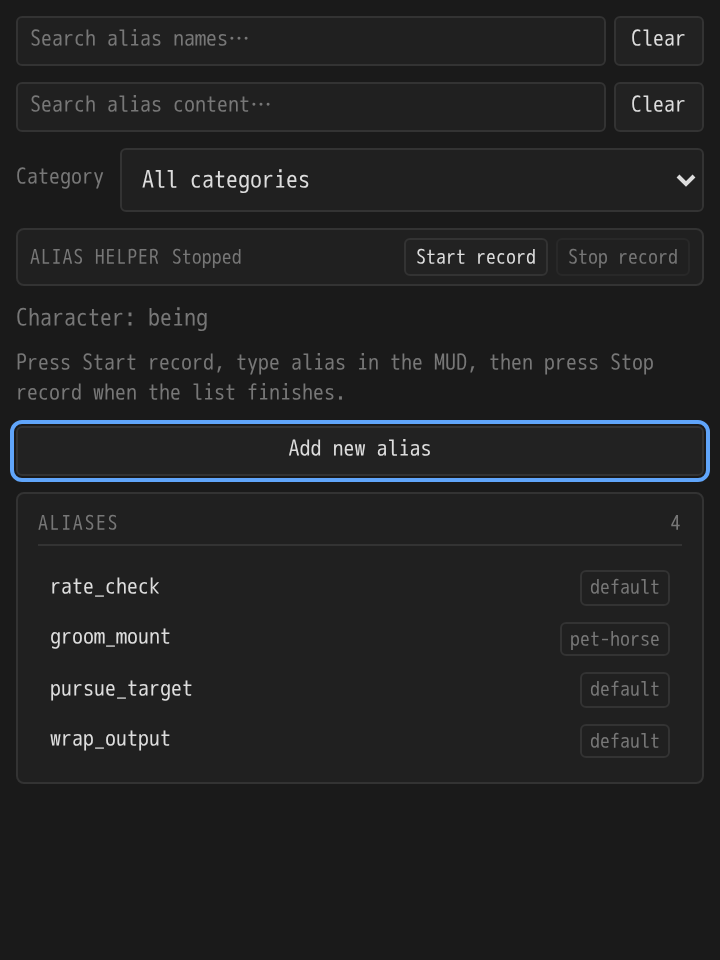
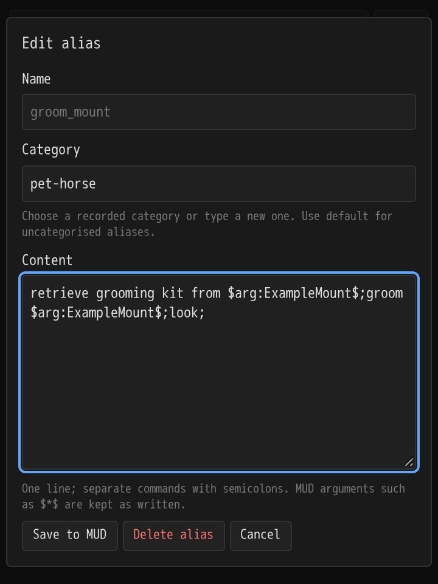

# Being's Discworld Alias Helper

A Mallard plugin for recording, searching and managing your Discworld MUD aliases. The panel uses the same compact, theme-aware styling as Being's Discworld Blorp Recorder. Requires Mallard 0.28.0 or later.

## Install

Download [version 1.1.0](https://github.com/bytechipper/beings-discworld-alias-helper/releases/download/v1.1.0/beings-discworld-alias-helper-1.1.0.mallardx), then install it with **Plugin manager → Install from file…**. Enable it for your Discworld world and open **Being's Discworld Alias Helper** from the panels menu. Allow sends and character GMCP access when requested.





## Use

1. Log in and wait for the panel to show your character's name. Discworld GMCP must be enabled.
2. Press **Start record**, then type `alias` in the MUD. The button starts listening; it does not type the command for you.
3. Let the whole list finish, including all pages if the MUD paginates it, then press **Stop record**. While recording, avoid unrelated commands or conversations that look like `name: content`.
4. Use **Search alias names** to filter names, **Search alias content** to filter commands inside aliases, and the **Category** dropdown to select a recorded category or **All categories**. All active filters must match. Searches ignore case and match literal text; each has its own **Clear** button. Categories are shown beside every alias, and the dropdown shows their saved alias counts.
5. Click an alias to open its editable content and **Category** field. Choose a recorded category from the suggestions or type a new name, then press **Save to MUD**. Use `default` to move an alias out of a named category. **Delete alias** asks for confirmation before sending `unalias <name>`.
6. Use **Add new alias** for an empty dialog with a name field and content area. Its category starts with the selected filter, or `default` when viewing all categories, and can be changed before saving. To overwrite a recorded name, open it from the list instead.

Alias bodies must be one logical line: use semicolons between MUD commands. The text area wraps long lines visually. `$*$`, `$1$`, `$arg:default$`, backslashes and punctuation are preserved. Existing names are read-only; changing an alias's name is outside this plugin's scope.

The recorder recognises both `name: content` and `name (colour replace): content`. The `(colour replace)` annotation is a listing label, so it is excluded from the saved name and content. After updating from 1.0.2 or earlier, record `alias` again to add previously skipped entries; clearing the saved list first is optional.

Content edits send `alias <name> <content>`, or `alias <name> in "<category>" <content>` to preserve a non-default category. Category-only edits send `alias set category <name> <category>` without rewriting content. If both fields change, the content command is sent first, followed by the category command. New aliases can be created directly in a chosen category. Category names cannot contain quotes, backslashes, semicolons or control characters. The MUD receives commands directly, bypassing client aliases and input processing. Reserved command names and bulk deletion forms are rejected.

Record `alias` once to populate categories, or record `alias show category sailing` to update only that category. Existing saved categories appear automatically after upgrading. The category dropdown is based on recorded aliases; category summaries from `alias show categories` are ignored so their counts never become bogus aliases. The dropdown returns to **All categories** when switching characters or when its selected category disappears from the saved list.

The list updates locally after sending a command. **Check MUD output for confirmation**: the plugin does not infer success from arbitrary server responses. After an error, record `alias` again to refresh. Recording merges entries and updates changed content; it does not remove entries absent from a listing, because the listing may be partial. Deletes made through this panel remove the saved entry. Prefer the panel's delete action for recorded aliases, since deletions made elsewhere leave a stale saved entry.

Lists persist separately for each character and world. Switching characters or disconnecting stops recording and closes any open editor. A stale editor cannot overwrite an alias changed by a fresh recording. Recording never sends a command.

Use `/aliases_clear` to clear all saved aliases for the current character in this world and stop recording. This clears the plugin's stored list only; it sends no commands to the MUD and keeps other characters' lists. Then start recording and type `alias` to build a fresh list. If you use a custom Mallard command prefix, use it instead of `/`.

## Development

Built against [Mallard's v0.28.0 plugin development guide](https://mallard.vnsf.xyz/docs/mallard-plugin-dev-v0.28.0.html) and [API reference](https://mallard.vnsf.xyz/docs/api-reference-v0.28.0.html). No external services or panel libraries are required.

```sh
python3 -m unittest discover -s tests -v  # Python 3.11+ and liblua5.4
python3 tests/panel_test.py             # Playwright with Chromium installed
python3 scripts/build.py               # Reproducible .mallardx archive
```

The runtime tests use invented examples and a generated 1530-alias listing, including 19 `(colour replace)` entries. They exercise category creation and moves, command validation and character changes, and check persistence and failure handling. Browser tests cover visible categories, combined filters and category editing using a mocked Mallard bridge. Player exports stay local and are ignored by Git. A live Discworld session is still needed to confirm server acceptance of commands.

For unpacked development, use a directory named `net.discworld.beings-discworld-alias-helper` in Mallard's dev plugins folder, then reload plugins.
